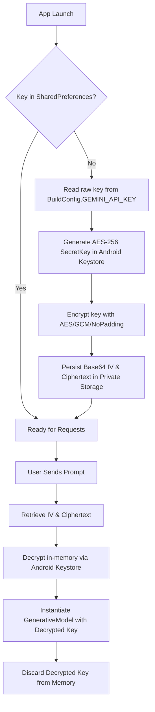

# Gemini Android Chat Application (Assignment 1)

A modern, responsive Android chat application built with **Jetpack Compose**, **Material 3**, and the **Google Gemini Generative AI SDK**. This project implements end-to-end features including hardware-backed API key security, conversation history with Room, persistent preferences with DataStore, speech-to-text input, and comprehensive testing.

---

## 1. Project Overview

This application serves as an interactive conversational AI interface powered by Google's Gemini models (`gemini-3.6-flash`, `gemini-3.8-flash`, `gemini-3.5-flash-lite`). Built following Google's official Android Architecture Guidelines, it uses:
- **Jetpack Compose & Material 3** for declarative, adaptive, and dynamic-themed UI.
- **Coroutines & StateFlow** with `collectAsStateWithLifecycle` for reactive and lifecycle-aware state management.
- **Android Keystore (AES-256-GCM)** for client-side API key encryption at rest.
- **Room Persistence Library** to store full conversation history across app restarts.
- **Preferences DataStore** for persisting model and user preferences.
- **Android Speech Recognizer** for voice-to-text prompt drafting.

---

## 2. Features Implemented

1. **Secure Gemini API Configuration**:
   - Reads `GEMINI_API_KEY` from `local.properties` during Gradle build.
   - Fallback support for `GEMINI_API_KEY` environment variable.
   - Key exposed strictly via `BuildConfig.GEMINI_API_KEY` without ever appearing in VCS.
   - `local.properties` git-ignored; `local.properties.example` template provided.

2. **Hardware-Backed API Key Security**:
   - Master key generated and securely stored in **Android Keystore** using **AES-256-GCM** (`AES/GCM/NoPadding`).
   - On first launch, the raw API key from `BuildConfig` is encrypted.
   - Only the encrypted ciphertext and initialization vector (IV) are persisted in local private storage.
   - Key is decrypted strictly in-memory when initializing the Gemini GenerativeModel.
   - R8 minification and code shrinking enabled for release builds (`isMinifyEnabled = true`).

3. **Material 3 Chat UI**:
   - Conversation displayed using `LazyColumn` with stable item keys (`key = { message.id }`).
   - Visually distinct chat bubbles for **User** (right-aligned, `primaryContainer`) and **Gemini** (left-aligned, `surfaceVariant` with avatar icon and bold markdown formatting).
   - Auto-scrolling to the newest message whenever new messages or response tokens arrive.
   - Clean, elevated input area with text input, send button, and voice input button.
   - Stateless composable architecture separating presentation from state management.

4. **Lifecycle-Aware State Management**:
   - Unidirectional data flow managed via `ChatUiState` and `ChatViewModel`.
   - Exposed as `StateFlow<ChatUiState>`.
   - Consumed safely in Jetpack Compose via `collectAsStateWithLifecycle()`.

5. **Loading & Error Handling**:
   - Visual thinking indicator with `CircularProgressIndicator` while Gemini generates responses.
   - User-friendly `SnackbarHost` displaying error notifications without application crashes.
   - Graceful handling of network errors, timeouts, and missing API keys.

6. **Responsive & Adaptive UI**:
   - Adapts to phone portrait, landscape orientations, and tablets using Compose constraints.
   - Chat column max-width bounded on large screens to prevent bubble stretching while maintaining full usability on phones.

7. **Dark Mode & Dynamic Theming**:
   - Comprehensive Material 3 theme supporting `isSystemInDarkTheme()`.
   - Android 12+ dynamic color palette support (`dynamicDarkColorScheme` / `dynamicLightColorScheme`).

8. **Voice Input (Speech-to-Text)**:
   - Speech recognition integration using `RecognizerIntent` and `rememberLauncherForActivityResult`.
   - Microphone button adjacent to chat input.
   - Recognized text is inserted into the message input field allowing the user to review and edit before sending.
   - Safe exception handling (`ActivityNotFoundException`) without crashes if voice services are missing.

9. **User Preferences (DataStore)**:
   - Implemented using Jetpack **Preferences DataStore**.
   - Persists selected Gemini model (`gemini-3.6-flash`, `gemini-3.8-flash`, `gemini-3.5-flash-lite`).
   - Accessible via the top app bar dropdown menu and restored across app restarts.

10. **Chat History (Room Database)**:
    - Persistent SQLite storage via Android **Room** (`ChatMessageEntity`, `ChatMessageDao`, `ChatDatabase`).
    - Reactively exposed as `Flow<List<ChatMessage>>`.
    - Automatically loads saved history on app launch and stores user and Gemini messages.
    - Includes option to clear conversation history.

11. **Automated Testing**:
    - **Unit Tests**: `ChatViewModelTest` covering prompt changes, validation errors, successful generation, API failures, voice results, and model selection using `kotlinx-coroutines-test` and test fakes.
    - **Compose UI Tests**: `ChatScreenTest` verifying empty state placeholders, message bubble rendering, loading indicators, input typing, and button interactions using `createComposeRule()`.

---

## 3. How to Configure GEMINI_API_KEY

### Step 1: Obtain a Gemini API Key
Generate an API key at [Google AI Studio](https://aistudio.google.com/).

### Step 2: Add the Key to `local.properties`
Create or edit the file named `local.properties` in the root directory of the project:

```properties
GEMINI_API_KEY=YOUR_REAL_API_KEY_HERE
```

> [!WARNING]
> **DO NOT COMMIT YOUR API KEY TO GIT!**
> - `local.properties` is strictly for local developer configuration and is already ignored in `.gitignore`.
> - Never hardcode API keys into Kotlin files, layout files, XML resources, or commit history.
> - A template file `local.properties.example` is provided for reference.

### Optional: Environment Variable Fallback
Alternatively, you can set the key as an environment variable in your terminal:

```powershell
$env:GEMINI_API_KEY="YOUR_REAL_API_KEY_HERE"
```

The Gradle build automatically checks `local.properties` first, falling back to the `GEMINI_API_KEY` environment variable.

---

## 4. Android Keystore & Encryption Flow

To safeguard the API key on the device, the app implements hardware-backed symmetric encryption:



1. **Key Generation**: A 256-bit AES master key is created with `KeyGenParameterSpec` inside the `AndroidKeyStore`. The key material remains isolated inside the secure hardware module (TEE/StrongBox) and cannot be extracted in plaintext.
2. **First-Launch Encryption**: On first run, the raw key is encrypted using `AES/GCM/NoPadding`. A random 12-byte initialization vector (IV) and the encrypted ciphertext with GCM authentication tag are saved to private `SharedPreferences`.
3. **On-Demand Decryption**: When a prompt is submitted, the ciphertext and IV are retrieved and decrypted in-memory solely to initialize the `GenerativeModel`. The decrypted key is never logged, toasted, or persisted to storage.

---

## 5. How to Run the Application

### In Android Studio
1. Open Android Studio.
2. Select **File > Open...** and navigate to the project directory:
   `e:\download\GeminiApiComposeStarter-master\GeminiApiComposeStarter-master`
3. Wait for Gradle sync to complete.
4. Add your API key in `local.properties`:
   ```properties
   GEMINI_API_KEY=your_actual_key
   ```
5. Select an Android Emulator or connected physical device (API level 26+).
6. Click **Run > Run 'app'** (`Shift + F10`).

### From the Command Line
```powershell
# Set JAVA_HOME to JDK 17+ (or Android Studio's bundled JBR)
$env:JAVA_HOME = "C:\Program Files\Android\Android Studio\jbr"
$env:ANDROID_HOME = "C:\Users\<username>\AppData\Local\Android\Sdk"

# Build debug APK
.\gradlew.bat assembleDebug

# Install on connected device or running emulator
.\gradlew.bat installDebug
```

---

## 6. How to Run Tests

### Unit Tests
Run unit tests for `ChatViewModel`, Room repository, and state flows:
```powershell
.\gradlew.bat testDebugUnitTest
```

### Instrumented Compose UI Tests
Ensure an Android device or emulator is running, then run:
```powershell
.\gradlew.bat connectedDebugAndroidTest
```
Or verify test compilation:
```powershell
.\gradlew.bat compileDebugAndroidTestSources
```

---

## 7. Security Limitations

> [!CAUTION]
> **Client-Side Security Limitations**:
> While using the Android Keystore with AES-256-GCM and enabling R8 minification protects the API key against casual inspection and static analysis of the APK file, **no client-side protection can completely prevent a determined attacker with physical device control or root access from extracting secrets**.
>
> An attacker with a rooted device or using dynamic instrumentation frameworks (such as Frida, Xposed, or runtime debuggers) can inspect in-memory allocations or hook cryptographic and network APIs to capture the key during runtime execution.

### Production Recommendations
For commercial and enterprise deployments:
1. **Backend Proxy / API Gateway**: Put all calls to the Gemini API behind an authenticated backend server. The mobile client authenticates with the backend (e.g. Firebase Auth / OAuth2), and the backend securely injects the Gemini API key without ever distributing it to mobile devices.
2. **App Attestation (Firebase App Check / Play Integrity)**: Use Firebase App Check or the Google Play Integrity API to ensure that requests originate only from legitimate, untampered instances of your app.
3. **API Key Restrictions**: In Google Cloud Console, restrict the API key by Android application package name and SHA-1 fingerprint, and apply quota limits to mitigate unauthorized usage.
